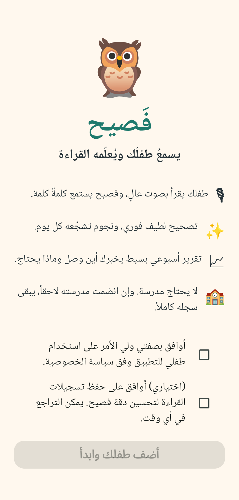
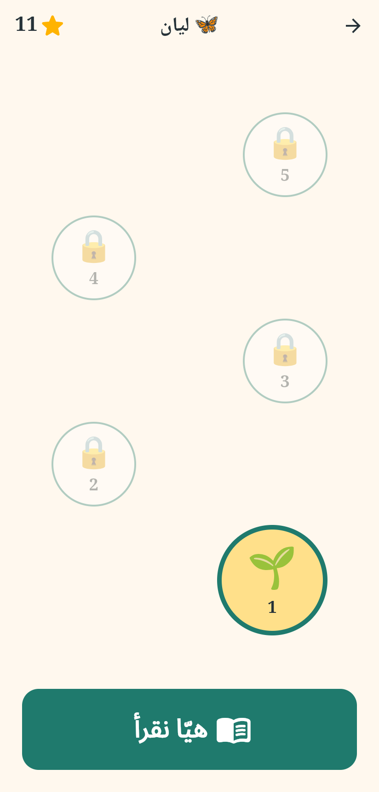
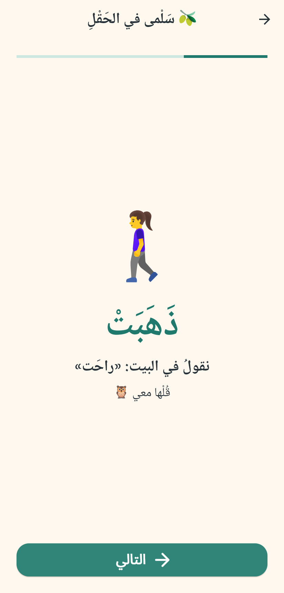
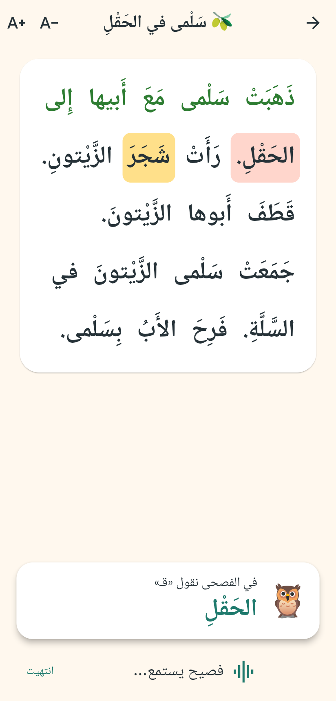
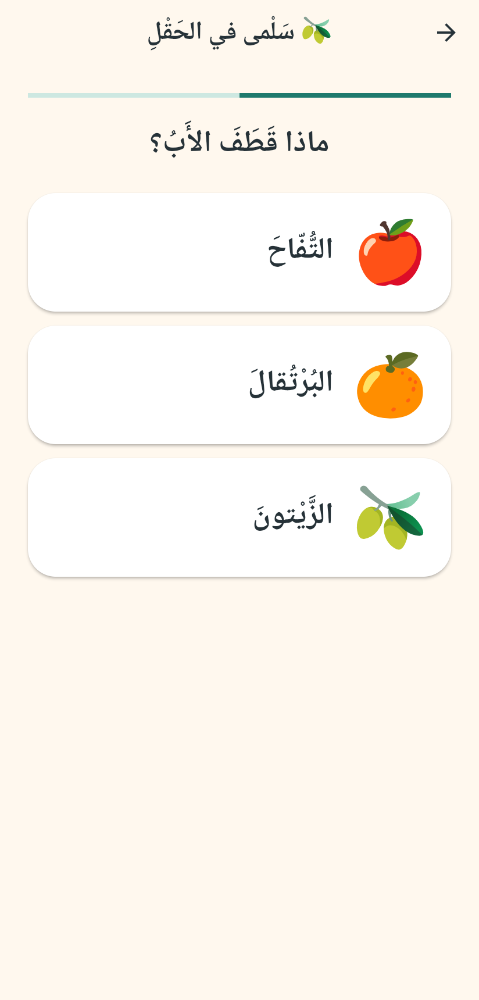
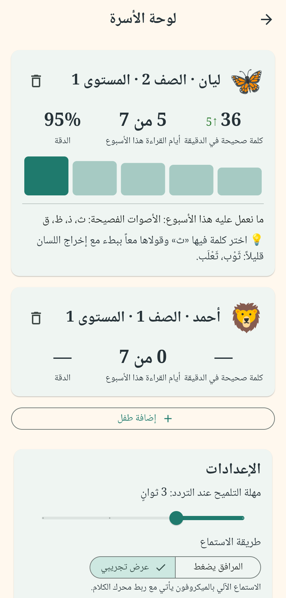

# فَصيح — مدرّب القراءة العربية الصوتي

تطبيق يستمع للطفل (الصفوف 1–4) وهو يقرأ نصاً مشكولاً بصوت عالٍ، ويكتشف أخطاءه كلمةً كلمة، ويصحح بلطف، ويعطي الأهل (والمعلمة إن وُجدت) صورة واضحة عن تقدّمه. يعمل **مع المدرسة أو دونها**: الأسرة تسجّل مباشرة، والارتباط بصف مدرسي اختياري.

وثيقة المنتج: [`docs/PRD.md`](docs/PRD.md)

| | | | |
|---|---|---|---|
|  |  |  |  |
|  |  |  | |

## ما بُني في هذه المرحلة

| الجزء | المكان | الحالة |
| --- | --- | --- |
| محرك التقييم: محاذاة القراءة مع النص المعلوم، وتصنيف الأخطاء حسب القسم 6.2 (استبدال، حذف، زيادة، حركة داخلية، حركة إعراب، إبدال لهجي، وقف بالسكون، تصحيح ذاتي، تكرار، تردد)، وحساب WCPM والدقة | `app/lib/engine/` | يعمل ومُختبَر |
| سياسة التغذية الراجعة: متى نقاطع الطفل ومتى نؤجل للملخص | `app/lib/engine/feedback_policy.dart` | يعمل ومُختبَر |
| تحديد المستوى (C-02) والمسار التكيّفي (C-02b) دون معلم | `app/lib/engine/leveling.dart` | يعمل ومُختبَر |
| تطبيق Flutter: تسجيل الأسرة دون مدرسة، الموافقات، إضافة حتى 5 أطفال، الدخول بالصورة، خريطة الرحلة، جسر العامية-الفصحى، شاشة القراءة، أسئلة الفهم، النجوم، لوحة الأسرة، بوابة الوالدين، حق الحذف | `app/lib/ui/` | يعمل محلياً على الجهاز |
| مكتبة نصوص أولية: 6 نصوص تدريب (المستويان 1–2) و3 نصوص لتحديد المستوى | `app/assets/content/texts.json` | **مسودة تحتاج مراجعة مختص لغة** |
| مخطط Supabase مع RLS: الأسرة تملك بيانات طفلها، والمعلمة ترى الطفل فقط بعد ربط بموافقة الأهل، وتصحيح المعلمة، وسجل تدقيق الاستماع للتسجيلات، والحذف التلقائي للصوت | `supabase/migrations/` | مُختبَر على Postgres محلي |

## طريقة الاستماع حالياً

محرك الكلام الحقيقي (نموذج صوتي على مستوى الفونيم مدرَّب على أصوات أطفال عرب) هو بوابة المرحلة 0، ولم يُربط بعد. إلى حينه يعمل التطبيق بوضعين:

- **المرافق يضغط** (الافتراضي): الطفل يقرأ وولي الأمر يضغط ✓ أو ✗ لكل كلمة. يعطي WCPM ودقة حقيقيين اليوم، ويصلح أداةً لجمع بيانات موسومة.
- **عرض تجريبي**: قارئ محاكى يرتكب أخطاء نموذجية (إبدال لهجي، خطأ حركة، تصحيح ذاتي، تردد) لتجربة الواجهة.

المحرك يستقبل كلمات مسموعة مع توقيتها (`HeardWord`)، مشكولة إن أمكن، فأي مصدر للتعرّف على الكلام يمكن وصله دون تغيير منطق التقييم.

## التشغيل

```bash
cd app
flutter pub get
flutter test               # 74 اختباراً: المحرك، والمحتوى، ورحلة الأسرة كاملة
flutter run                # على جهاز أندرويد أو محاكٍ
flutter run -d chrome      # أو في المتصفح
```

اختبار مخطط قاعدة البيانات وسياسات RLS على Postgres محلي:

```bash
PGUSER=postgres supabase/tests/run.sh
```

## الخطوات التالية المقترحة

1. **محرك الكلام (بوابة المرحلة 0):** مقارنة 3–4 نماذج على تسجيلات أطفال حقيقية، ثم وصل الفائز عبر `HeardWord`. إضافة التسجيل الصوتي (`record`) والنطق النموذجي (تسجيلات بشرية للنصوص).
2. **مراجعة المحتوى** مع مختص لغة وقراءة مبكرة، وإكمال 12 نصاً لكل مستوى.
3. **المزامنة مع Supabase:** تسجيل الدخول برقم الهاتف وOTP، و`create_family()`، ورفع الجلسات.
4. **الربط بمدرسة (P-09)** عبر `join_class()`، ثم لوحة المعلمة (ويب).
5. **الاشتراك والدفع (P-07)** بعد التجربة المغلقة لقناة الأسرة.
